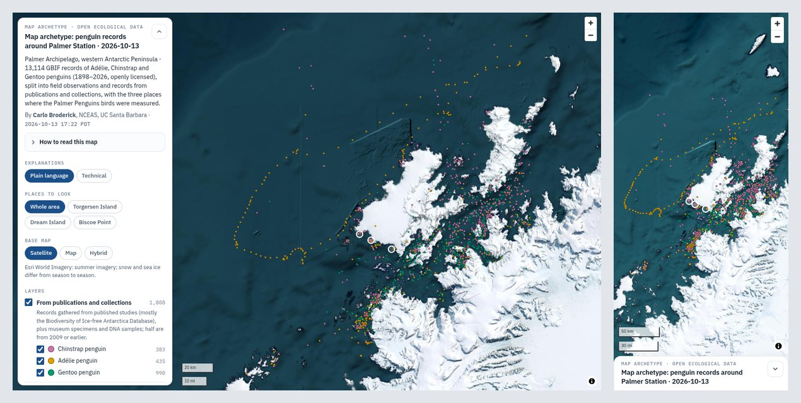
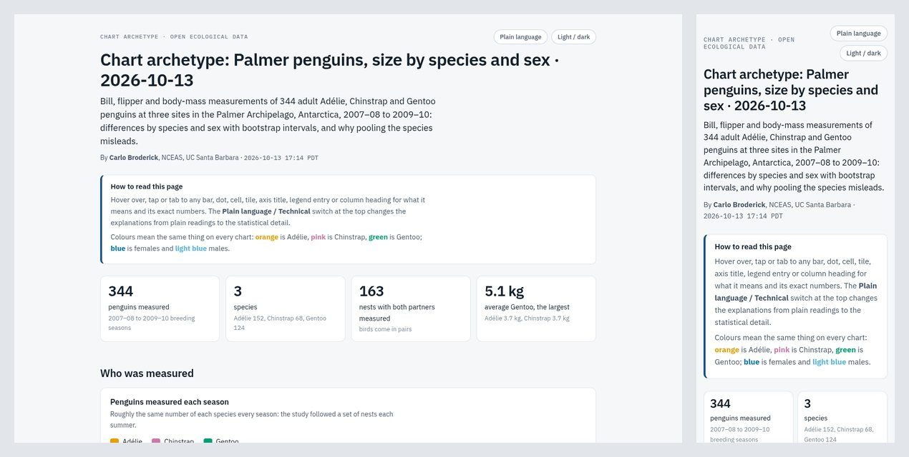
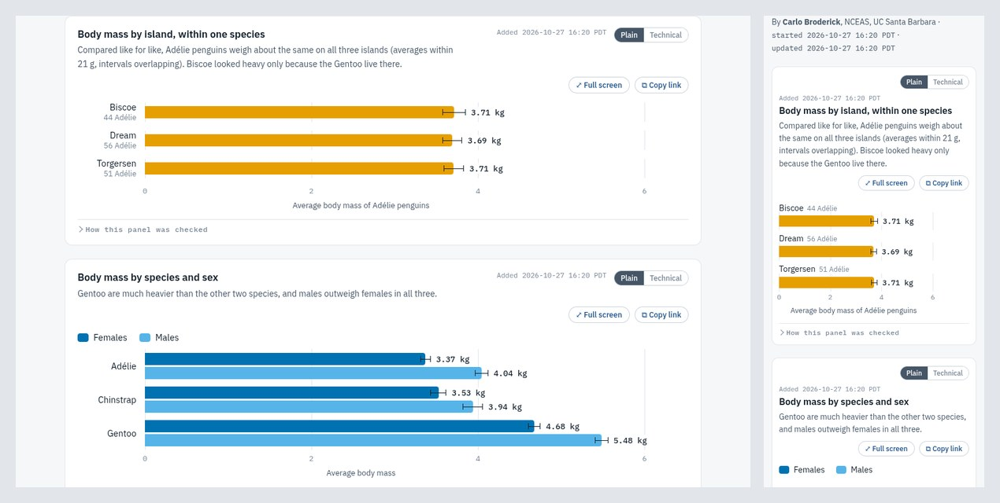
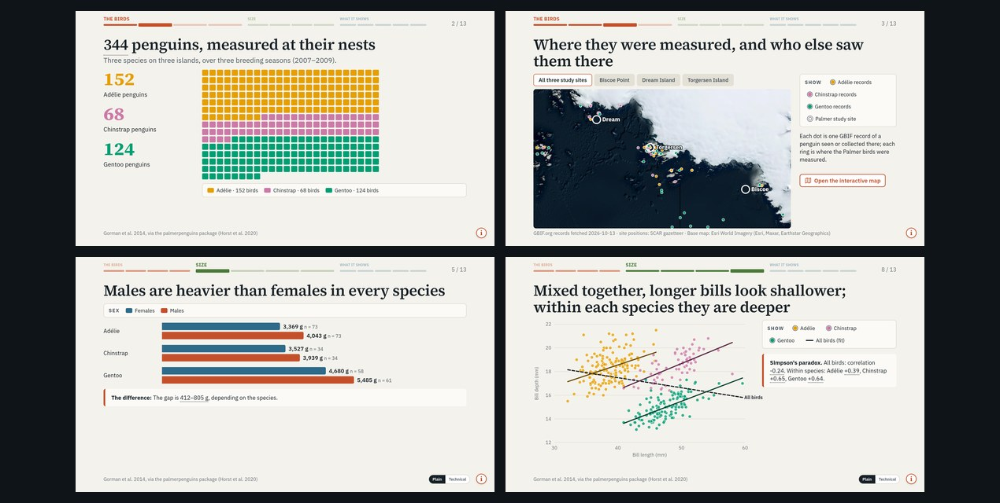

# Coding-Agent Skills for Data Science

Ready-made **skills** that teach AI coding agents to do whole data-science jobs the way a research team
does them: build the thing, check it, publish it, and hand back a link. A skill is a folder of
instructions plus the scripts, templates and references the agent uses for one kind of job. Your agent
loads a skill only when the job comes up. Point your agent at this repo and it installs a
**personalized copy** that fits your tool, your machine and your team.

The companion to [Coding-Agent Rules for Data Science](https://github.com/NCEAS-AI/Coding-Agent-Rules-for-Data-Science):
**rules** shape how the agent behaves all the time (reproducibility, real data only, careful with your
machine); **skills** are how it does a specific job well.

This is a **living repo**: the skills are used every day and keep improving, and new ones will be added.
What you install is a snapshot, so re-run the setup whenever you want the latest.

## Quick Start Prompt
<b>Paste the prompt below into your coding agent:</b>
<br>(Claude Code, Cursor, Codex, GitHub Copilot, Gemini CLI, and other tools that read Agent Skills)</br>

```text
Install a skill from this public repo for me: https://github.com/NCEAS-AI/Coding-Agent-Skills-for-Data-Science
Read the setup guide at https://github.com/NCEAS-AI/Coding-Agent-Skills-for-Data-Science/blob/main/agent-setup/SETUP.md
and follow it: figure out which tool I'm using and where its skills go, check that my machine has what
the skill needs, ask me the setup questions, and show me exactly what you will install and where
before you write anything.
```
<b>The agent will:</b>

1. Ask how you want to run setup: let it check your machine and fill in what it can, or answer everything yourself.
2. Work out which tool you use and where that tool looks for skills.
3. Check what the skill needs (Python, git, Chrome) and whether you can publish to your GitHub Pages site.
4. Ask the questions only you can answer: your name for the byline, your team and site, whether pages publish without asking.
5. Install the skill, keep your personal settings outside the skill folder (so updates never overwrite them), and test it.

Prefer to do it by hand? [`agent-setup/SETUP.md`](agent-setup/SETUP.md) reads fine on its own. Or copy a
skill folder from [`skills/`](skills/) into your tool's skills folder (table below), or upload
[`dist/wri-html-pages.skill`](dist/wri-html-pages.skill) (and [`dist/wri-html-decks.skill`](dist/wri-html-decks.skill))
to claude.ai.

## The skills

### `wri-html-pages`: data visualizations as web pages, published by link

Ask for any chart, map or table ("map these survey sites by species", "chart body mass by species and
sex", "add a panel with the yearly totals") and the agent builds an interactive HTML page in a
consistent house style, checks every panel for statistical rigor, looks at it on a desktop and a phone,
publishes it to your team's GitHub Pages site, and gives you the link. Made by and for the
[Wildfire Resilience Index](https://wildfireindex.org/) team at [NCEAS](https://www.nceas.ucsb.edu/);
any team with a GitHub Pages site can use it.

The example pages below are built from open ecological data anyone can download: the
[Palmer Penguins](https://allisonhorst.github.io/palmerpenguins/) measurements and GBIF records of the
same penguin species around Palmer Station, Antarctica. Their scripts are in
[`skills/wri-html-pages/examples/`](skills/wri-html-pages/examples/) and run anywhere.

| Map | Chart page | A page built over several requests |
|---|---|---|
| [](https://wri-science.github.io/public_publication/publication_htmls/style_archetypes/map-archetype-penguin-records-around-palmer-station-2026-10-13.html) | [](https://wri-science.github.io/public_publication/publication_htmls/style_archetypes/chart-archetype-palmer-penguins-size-species-sex-2026-10-13.html) | [](https://wri-science.github.io/public_publication/publication_htmls/style_archetypes/exploration-archetype-palmer-penguins-built-step-step-2026-10-13.html) |
| [Open the live map](https://wri-science.github.io/public_publication/publication_htmls/style_archetypes/map-archetype-penguin-records-around-palmer-station-2026-10-13.html) | [Open the live chart page](https://wri-science.github.io/public_publication/publication_htmls/style_archetypes/chart-archetype-palmer-penguins-size-species-sex-2026-10-13.html) | [Open the live page](https://wri-science.github.io/public_publication/publication_htmls/style_archetypes/exploration-archetype-palmer-penguins-built-step-step-2026-10-13.html) |

What every page gets, without being asked:

- **A short, dated title and a detailed subtitle**, a byline with who made it and when, and the team's
  logos and GitHub links. The file name is the title, so links say what they are.
- **Hover explanations on every part** (bars, points, cells, axes, legend entries), in plain language
  that suggests a reading, with a switch to the technical detail. The cursor never changes.
- **A rigor pass on every panel before it is published:** like-for-like periods, no partial years
  next to full ones, the right denominator, single events that dominate a total shown as such,
  uncertainty from the independent unit, and claims no stronger than the evidence. Each panel records
  what was checked.
- **Phone and desktop layouts** chosen chart by chart: redraw narrow, scroll with frozen headers, or turn
  into cards. Pages are checked so they never scroll sideways on a phone.
- **Living pages:** a new request adds its panels to the top of the current page, each with when it was
  added; obsolete or wrong panels come off with the reason kept in a page history.
- **Maps you can pan and zoom** (MapLibre GL JS): satellite, aerial and street base maps, layer filters
  with counts, "places to look" tabs, and maps as panels inside chart pages.
- **Published automatically and linked in every reply:** open by default, with an optional PIN gate.

The skill's own guide is [`skills/wri-html-pages/README.md`](skills/wri-html-pages/README.md); what the
agent reads is [`SKILL.md`](skills/wri-html-pages/SKILL.md) and the
[`references/`](skills/wri-html-pages/references/) it points to.

### `wri-html-decks`: presentations as HTML slide decks, published by link

Ask for a presentation ("make a deck on the validation results for Monday", "add a slide with the new
numbers", "give the map slide tabs for the three sites") and the agent builds one HTML deck in the same house
style, renders and checks every slide, publishes it to your GitHub Pages site next to your maps and charts, and
gives you the link. It is made from the team's best-received deck (a 74-slide wildfire structure-loss deck,
Sept–Oct 2026) and the feedback on it, and needs `wri-html-pages` installed beside it.

[](https://wri-science.github.io/public_publication/publication_htmls/style_archetypes/deck-archetype-palmer-penguins-species-sex-island-2026-10-23.html)

[Open the live deck](https://wri-science.github.io/public_publication/publication_htmls/style_archetypes/deck-archetype-palmer-penguins-species-sex-island-2026-10-23.html) (arrow keys to move, hover over anything).

What every deck gets, without being asked:

- **Real 16:9 slides** that scale to any screen, with keys, swipe, full screen and a PDF button.
- **A progress strip at the top of every slide,** grouped into the deck's sections in their own colours:
  what you've seen, where you are, what's left.
- **One idea per slide,** shown rather than written: headline numbers, unit grids, numbered steps, bracket
  flowcharts, cards in their concept's colour, statement slides.
- **Charts and maps drawn for the slide:** bars, columns, lines, intervals, scatter, time spans, class scales,
  shaded tables; maps as still pictures with tabs and layer toggles plus a link to the interactive map.
- **Hover tips on every part, with a highlight and no cursor change,** an (i) note on every slide, and a Plain |
  Technical switch where there is technical detail.
- **One link, kept up to date,** with the deck's change history in its Contents panel; two languages in one
  deck when needed.
- **Every slide checked** in headless Chrome for overflow, squeezed charts, overlapping text, dense slides and
  numbers without a hover.

Its guide is [`skills/wri-html-decks/README.md`](skills/wri-html-decks/README.md); the agent reads
[`SKILL.md`](skills/wri-html-decks/SKILL.md) and [`references/`](skills/wri-html-decks/references/).

## What are skills? (Read this: unlike rules, skills include code)

A skill is a folder with a `SKILL.md` file: a name, a one-paragraph description of when to use it, and
instructions. Your agent keeps only the name and description in mind, and reads the rest when a task
matches. The format is the open [Agent Skills](https://agentskills.io) standard, so one folder works in
many tools.

**Unlike the rules repo, these skills include scripts that your agent will run.** `wri-html-pages` runs
Python scripts that build HTML pages, start a headless Chrome to screenshot them, and `git push` pages to
the GitHub Pages repo you choose; `wri-html-decks` builds decks, screenshots every slide the same way, downloads
base-map tiles for still maps, and publishes with `wri-html-pages`. Nothing phones home. The scripts talk to GitHub (to publish a page and
confirm it is live); the example scripts download their open data once (Palmer Penguins, GBIF, the SCAR
gazetteer); and the pages, like any web map, load map tiles and JavaScript libraries from public servers
when opened. Please read before
you install; everything is plain text:

- [`SKILL.md`](skills/wri-html-pages/SKILL.md): what the agent is told to do, and when.
- [`scripts/`](skills/wri-html-pages/scripts/): every script it runs, each with a header saying why it
  exists and what it does.
- [`agent-setup/SETUP.md`](agent-setup/SETUP.md): exactly what the installer does on your machine.

Publishing is automatic by default (the agent pushes without asking, which is how the team works). Pages
on GitHub Pages are public to anyone with the link, so the setup asks whether you want that. Data you
tell the agent are private, embargoed or licensed for internal use are not published openly without
asking.

## Works with

Copy a skill folder (the one with `SKILL.md` at its top) into your tool's skills folder, then start a new
session. Checked against each tool's documentation on 2026-10-13; these change, so the setup checks again.

| Tool | Personal (all projects) | One project | Docs |
|---|---|---|---|
| Claude Code | `~/.claude/skills/` | `.claude/skills/` | [skills](https://code.claude.com/docs/en/skills) |
| Claude (claude.ai, desktop) | upload `dist/<name>.skill` in Settings → Capabilities → Skills | | [skills](https://platform.claude.com/docs/en/agents-and-tools/agent-skills/overview) |
| Cursor | `~/.cursor/skills/` or `~/.agents/skills/` (also reads `~/.claude/skills/`) | `.cursor/skills/` or `.agents/skills/` | [skills](https://cursor.com/docs/context/skills) |
| Codex | `~/.agents/skills/` | `.agents/skills/` | [skills](https://learn.chatgpt.com/docs/build-skills) |
| GitHub Copilot (VS Code, CLI) | `~/.copilot/skills/` or `~/.agents/skills/` | `.github/skills/` or `.agents/skills/` | [skills](https://docs.github.com/en/copilot/concepts/agents/about-agent-skills) |
| Gemini CLI | `~/.gemini/skills/` or `~/.agents/skills/` | `.gemini/skills/` or `.agents/skills/` | [skills](https://geminicli.com/docs/cli/skills/) |
| Others | see the [Agent Skills client list](https://agentskills.io) | | |

`~/.agents/skills/` is read by Cursor, Codex, Copilot and Gemini CLI, so it is the most portable
choice; Claude Code reads `~/.claude/skills/` (which Cursor also reads). On claude.ai a skill can build
pages but cannot push them to GitHub.

## What's in here

| Path | What it is |
|---|---|
| `agent-setup/SETUP.md` | The setup protocol the agent follows. Start here. |
| `skills/wri-html-pages/` | The page skill: `SKILL.md`, `references/`, `scripts/`, `assets/`, `examples/`, and a `README.md` for people. |
| `skills/wri-html-decks/` | The deck skill, same layout (it uses `wri-html-pages` for settings and publishing). |
| `dist/<name>.skill` | Each skill folder as a zip, for uploading to claude.ai or sending to someone. |
| `docs/img/` | The screenshots above. |
| `tools/skills.py` | Checks skills against the Agent Skills spec, packages them, and syncs a working copy into this repo. |
| `CONTRIBUTING.md` | How to update a skill or add a new one. |
| `LICENSE` | CC0 1.0, public domain (the two logos excepted; see below). |
| `CITATION.cff` | Citation metadata. |

## Design notes

- **One folder, many tools.** Skills follow the open Agent Skills format, so the same folder works in
  Claude Code, Cursor, Codex, Copilot, Gemini CLI and more. Nothing in a skill is specific to one tool
  except where its docs say so (claude.ai can't push to GitHub).
- **Your settings live outside the skill.** Personal details (your name, team, logos, publishing site) go
  in `~/.config/<skill>/identity.json`, so installing a newer version never overwrites them.
- **The house style is the point.** Skills carry a team's standing preferences, each with the reason it
  exists, so the agent makes the same choices a careful team member would. Change a preference by
  telling your agent; it updates the skill's references and rebuilds the reference pages.
- **Real data only.** Every number on a page is computed from the data files by the page's script;
  the skill never types in numbers or fills gaps with made-up data.
- **Checked before it ships.** Scripts check titles, links, local paths, phone layouts and page errors
  before anything is published, and the agent screenshots every page and runs a rigor pass on every panel.

## License

Released under [CC0 1.0 Universal](LICENSE): public domain. Copy, modify and use it for any purpose; no
attribution required. **Except the logos:** `skills/wri-html-pages/assets/nceas-logo.svg` (National
Center for Ecological Analysis and Synthesis) and `skills/wri-html-pages/assets/wri-logo.png` (Wildfire
Resilience Index) belong to those organisations and are not covered by CC0. If you are not on those
teams, the setup replaces them with your own.

---

## Cite us!

<div align="center">

✨🎉🫶 &nbsp; **Citation isn't required, but if you're a true homie you will!** &nbsp; 🫶🎉✨

[](CITATION.cff)
&nbsp;
[](LICENSE)

</div>

Citation metadata lives in [`CITATION.cff`](CITATION.cff); GitHub renders a **"Cite this repository"**
button from it, and a Zenodo DOI will appear at the top of this README once archived.

📋 **Copy-paste citation:**

> Broderick, C. (2026). *Coding-Agent Skills for Data Science* (Version v1.1.0) [Software].
> https://github.com/NCEAS-AI/Coding-Agent-Skills-for-Data-Science

---
